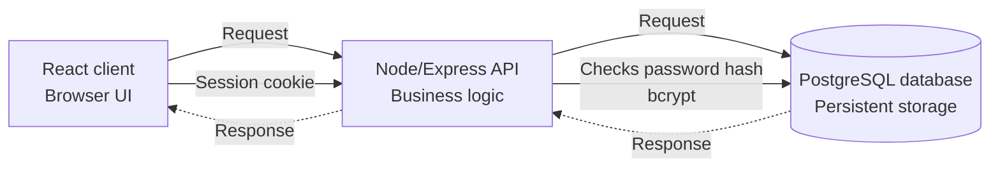
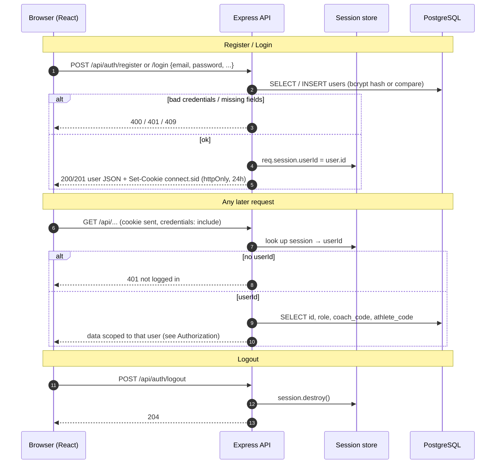
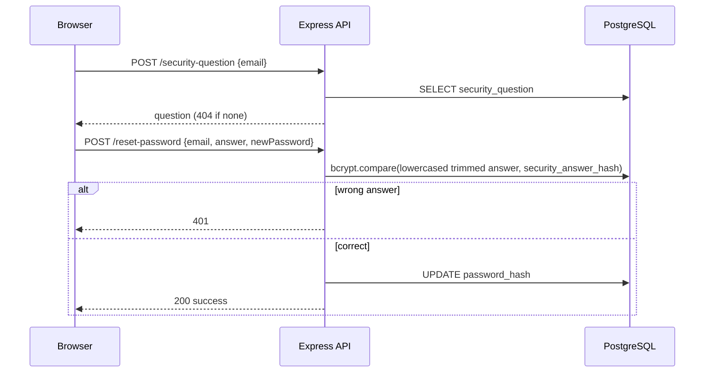
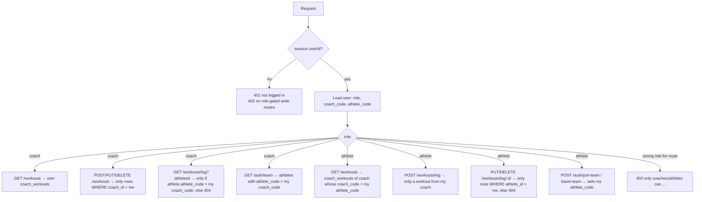

---

## Authentication

Session-cookie auth (`express-session`). Passwords and security answers are bcrypt-hashed; the session only stores `userId`.

### Password reset (no session needed)

## Authorization

Every protected route loads the user from `req.session.userId`, then checks **role** and **team membership** (an athlete's `athlete_code` equals their coach's `coach_code`).

| Route | Not logged in | Coach | Athlete |
|---|---|---|---|
| `GET /api/auth/me` | 401 | self | self + coach name |
| `GET /api/auth/team` | 401 | own team | empty list |
| `POST /api/auth/join-team`, `leave-team` | 401 | allowed (no role check) | allowed |
| `GET /api/workouts` | 401 | own templates | coach's templates |
| `POST/PUT/DELETE /api/workouts` | 403 | own templates only | 403 |
| `GET /api/workouts/log` | 401 | team athlete via `?athleteId` | own logs |
| `POST /api/workouts/log`, `PUT/DELETE /log/:id` | 403 | 403 | own logs only |
